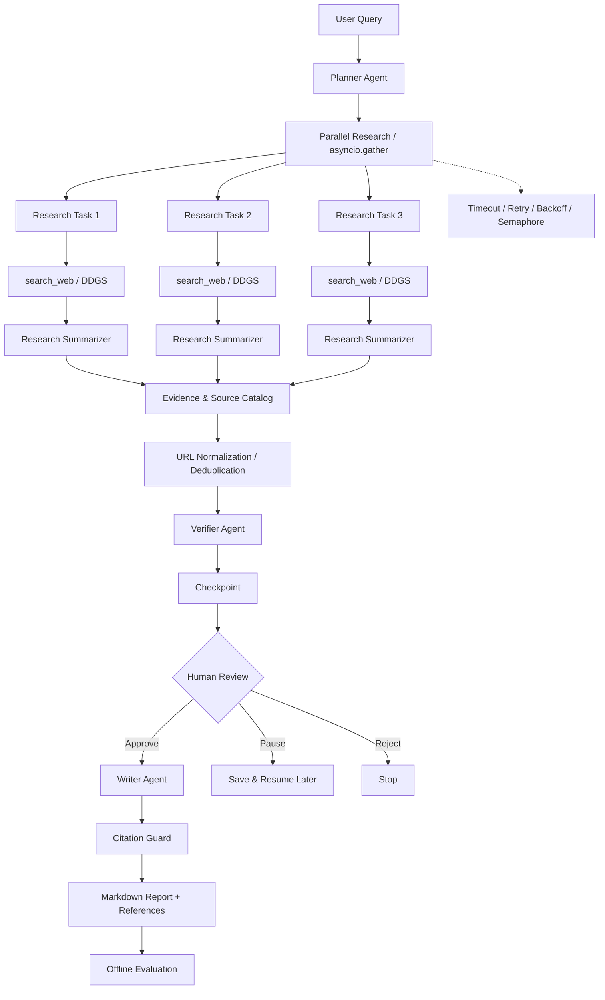

# Deep Research Agent｜多阶段研究与报告生成系统

> 基于 **OpenAI Agents SDK + DeepSeek + Python asyncio** 的研究型智能体项目。通过任务规划、联网搜索、并发研究、证据检查与引用约束，生成可追溯的 Markdown 研究报告。
>
> **项目状态：学习与演示原型**。本文列出的是项目当前设计和代码中已有的能力；真实效果、吞吐和事实准确性需要在本地运行与评测后确认。

## 1. 项目背景

复杂研究问题往往无法通过一次模型调用得到全面且有据可查的结论。该项目将任务拆成若干阶段：**Plan → Research → Verify → Write → Citation Guard**，并添加 Timeout、Retry、Checkpoint 与 Human-in-the-loop（人工审核）等工程机制。

与单次聊天式问答相比，它强调**研究过程可拆分、搜索来源可记录、执行状态可恢复**。

## 2. 架构设计



> **设计说明**：图中的 Checkpoint 是阶段级 JSON 状态保存，不是 OpenAI Agents SDK 内部每轮 Tool Call 的全量持久化。Verifier 当前主要检查搜索摘要与结论的一致性，无法替代全文事实核验。

更详细的模块解释见 [`docs/architecture.md`](docs/architecture.md)。

## 3. 主要能力

| 模块 | 作用 | 实现方式 |
|---|---|---|
| Planner | 将复杂研究问题拆成 3 个子任务 | DeepSeek + Prompt JSON + Pydantic |
| Researcher | 触发真实网页搜索 | OpenAI Agents SDK Function Tool + DDGS |
| Summarizer | 整理各研究任务的搜索证据 | 无工具的独立 Agent |
| Parallel Research | 并发执行子任务 | `asyncio.gather()` |
| Evidence Deduplication | URL 标准化、去重与来源编号 | Python / 字典 |
| Verifier | 检查结论与摘要证据的一致性 | 独立 Agent |
| Citation Guard | 检查引用编号、URL 白名单并生成 References | Python / 正则表达式 |
| Reliability | 单任务超时、重试、退避和并发限制 | `wait_for` / `Semaphore` |
| Checkpoint | 保存并恢复阶段结果 | 本地 JSON + Pydantic |
| HITL | 报告生成前人工批准、拒绝或暂停 | CLI 审批 |
| Evaluation | 离线统计任务与引用的规则指标 | Python，无需 LLM |

**已知局限**：免费 DDGS 可能受到搜索服务可用性或限流影响；模型调用通常产生 API 费用；Citation Guard 只能检验编号与登记 URL，不能保证引用网页真正支持某项事实；当前 Checkpoint 不支持多实例并发写入和子任务级精确恢复。

## 4. 技术栈

- **语言**：Python 3.12（开发环境）
- **Agent 框架**：OpenAI Agents SDK
- **大模型**：DeepSeek API（OpenAI Chat Completions 兼容调用方式）
- **联网搜索**：`ddgs`（无需专用搜索 API Key，依赖第三方公开搜索服务）
- **异步编排**：`asyncio`、`asyncio.to_thread()`
- **数据校验**：Pydantic
- **持久化**：本地 JSON Checkpoint
- **离线评测**：Python 单元测试与自定义指标

## 5. 目录结构

```text
deep-research-agent/
├── app/
│   ├── __init__.py
│   ├── config.py              # DeepSeek 客户端与模型配置
│   ├── models.py              # Plan / Task / Evidence / Source
│   ├── agents.py              # Planner / Researcher / Summarizer / Verifier / Writer
│   ├── tools.py               # search_web 工具（DDGS）
│   ├── workflow.py            # 工作流主流程
│   ├── verification.py        # URL 规范化和来源去重
│   ├── citation_guard.py      # 引用白名单与 References
│   ├── reliability.py         # 超时、重试、退避、信号量
│   ├── checkpoint.py          # 阶段级状态持久化
│   └── review.py              # CLI 人工审核
├── docs/
│   ├── architecture.md        # 架构设计与模块解释
│   └── demo.md                # 演示步骤与截图清单
├── checkpoints/               # 本地运行生成，勿提交（含研究内容）
├── eval_reports/              # 本地评测生成，默认勿提交
├── run.py                      # 命令行入口
├── evaluate_run.py             # 从历史 Checkpoint 离线评测
├── test_checkpoint.py          # Checkpoint 测试（若已创建）
├── test_reliability.py         # Reliability 测试（若已创建）
├── test_citation_guard.py      # Citation Guard 测试（若已创建）
├── test_evaluation.py          # Evaluation 测试（若已创建）
├── .env.example
├── .gitignore
└── requirements.txt
```

> 上述测试脚本请按你本地已完成的文件为准；README 列举了五天课程中的推荐结构，不应当把不存在的文件写成已经提交的实现。

## 6. 安装与运行

### 6.1 安装依赖（PowerShell）

```powershell
python -m venv .venv
.\.venv\Scripts\Activate.ps1
pip install -r requirements.txt
```

`requirements.txt` 应至少包含：`openai-agents`、`openai`、`python-dotenv`、`pydantic`、`ddgs`。本仓库提供适用于 Python 3.12 的核心依赖版本；请先运行离线测试，再配置模型服务。

### 6.2 环境变量

```powershell
Copy-Item .env.example .env
```

编辑 `.env`，设置 `DEEPSEEK_API_KEY`、`DEEPSEEK_BASE_URL` 和 `DEEPSEEK_MODEL`。不要上传真实密钥。

### 6.3 开始研究

```powershell
python run.py
```

输入研究问题。程序将自动规划研究任务、并行搜索、整合证据、核查结果，并在 CLI 显示人工审批：

- `y`：批准，继续生成报告
- `n`：拒绝，终止报告生成
- `q`：暂停并保存 Checkpoint，稍后再次输入同样问题可以恢复

强制重新研究：

```powershell
python run.py --fresh
```

> 相同问题默认使用历史 Checkpoint。若希望获取新的互联网资料，应主动使用 `--fresh`；该操作可能重新产生模型 API 消耗。

## 7. 测试与评测

**本地规则测试**（前提是对应测试文件已在你的工程中）：

```powershell
python test_reliability.py
python test_checkpoint.py
python test_citation_guard.py
python -m unittest test_evaluation.py -v
```

**离线评测已完成的任务**：

```powershell
python evaluate_run.py
```

默认读取最近一个已完成的 Checkpoint，计算：

- Research Success Rate：有有效来源的任务比例（代理指标）
- Citation Validity Rate：正文引用编号属于登记目录的比例
- Source Utilization Rate：被正文引用的登记来源占比
- Report Structure Coverage：预定章节覆盖率
- Uncited Paragraph Count：疑似缺少引用的较长段落数

**这些指标不能当作事实正确率**；也不能因为测试脚本可运行就宣称生产验证通过。实际结果见本地 `eval_reports/`，公开仓库前必须检查是否含敏感内容。

## 8. Demo

参见 [`docs/demo.md`](docs/demo.md)，推荐演示“新问题 → 研究 → 人工暂停 → 相同问题恢复 → 批准 → 报告 → 离线评测”的完整闭环。

## 9. 可靠性与安全边界

- 搜索结果属于外部不可信数据，不能将其中的自然语言指令当作系统指令执行。
- 限流和重试目前主要针对研究阶段；模型或搜索服务是否支持取消及重试，取决于底层实现。
- 通过来源白名单并不代表完成事实级验证。
- 本地 JSON Checkpoint 适合单机演示，不适合直接作为多实例共享的生产状态存储。
- 不上传 `.env`、密钥、Checkpoints、原始用户研究内容及未经脱敏的评测报告。

## 10. 后续方向

1. 子任务级 Checkpoint 与失败子任务单独恢复
2. 全文抓取与 Claim–Evidence 对齐，提高事实级引用可靠性
3. 统一请求 ID、结构化日志与更完整的延迟和成本统计
4. 多场景 Benchmark，人工标注与 LLM-as-a-Judge 结合
5. FastAPI / 简单前端、任务队列与更完善的审批服务

---

本项目为个人学习和研究型开发项目。系统输出仅供研究参考，需要结合原始来源进一步核验。
