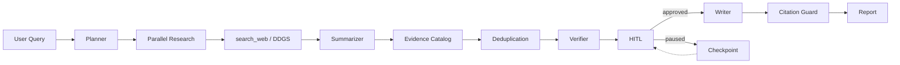

# Deep Research Agent 架构说明

## 一、项目设计目标

把复杂的研究问题从单次 LLM 回答拆解为独立、可追踪的研究任务，并在生成报告前核查证据、约束引用。当前为命令行演示版本，主要面向 Agent 开发实习的工程实践。

## 二、执行链路



### 分层理解

1. **Agent 定义层**（`agents.py`）：声明角色、Prompt、可用工具和 Agent 行为。Planner 只负责规划；Researcher 负责触发搜索；Summarizer 负责整理；Verifier 负责判断摘要证据一致性；Writer 负责成文。
2. **工具层**（`tools.py`）：使用 `@function_tool` 将 `search_web` 暴露给模型；真实查询由 Python 和 DDGS 完成。模型自己不执行网络调用。
3. **工作流层**（`workflow.py`）：通过 Python 明确编排阶段；研究任务通过 `asyncio.gather()` 并发执行。
4. **可靠性层**（`reliability.py`）：使用 Timeout、Retry、指数退避与 `Semaphore`。本地信号量仅控制当前受保护任务批次，不是跨服务器的分布式限流。
5. **证据层**（`models.py`、`verification.py`）：保留来源 `title/url/snippet` 并对 URL 去重，形成来源编号目录。
6. **输出审计层**（`citation_guard.py`）：仅允许报告引用已登记编号及 URL，自动生成 References；不代表证据内容真的支持所附结论。
7. **状态管理与人工审批层**（`checkpoint.py`、`review.py`）：在主要阶段之后保存 JSON，人工批准后才进入 Writer。
8. **评测层**（`evaluation.py`）：对已完成任务进行无额外模型调用的规则评测。

## 三、核心数据流

```text
ResearchPlan
  topic
  tasks: ResearchTask[]

ResearchTask
  title / query / goal

ResearchEvidence
  task_title / query / content
  sources: ResearchSource[]

ResearchSource
  title / url / snippet

CheckpointState
  run_id / query / stage
  plan / evidence_list / source_catalog
  verification_report / review_status / final_report
```

## 四、异常与恢复

- **模型 400**：优先检查模型兼容参数与输出格式，不应该盲目重试。
- **临时网络失败/限流**：有限重试，退避等待，仍保留失败记录。
- **单任务失败**：保留其他成功任务结果，不虚构证据；全部失败则终止。
- **人工暂停**：保存状态，重新输入相同研究问题后恢复。
- **进程在 Research 阶段中断**：由于是阶段级持久化，未保存的阶段可能重新执行。
- **状态文件损坏/并发写入**：当前版本缺少事务性状态管理和多进程锁，属于已知局限。

## 五、面试讲述重点

> 本项目把复杂研究任务拆分成多个可并行执行的研究单元，使用 Agents SDK 组织模型和工具调用，Python 明确编排流程。在研究结果生成后做来源去重和摘要证据核查，输出时使用程序化 Citation Guard 检查引用合法性。同时增加单任务超时重试、并发限制以及阶段级 Checkpoint 和人工审批，提高演示场景下的可恢复性与结果可追溯性。

**不要直接宣称**：已解决所有幻觉、具备严格事实级审查、完成生产级部署、实现多实例分布式恢复、实现真实成本降低 X%。这些需要独立测试数据支持。
